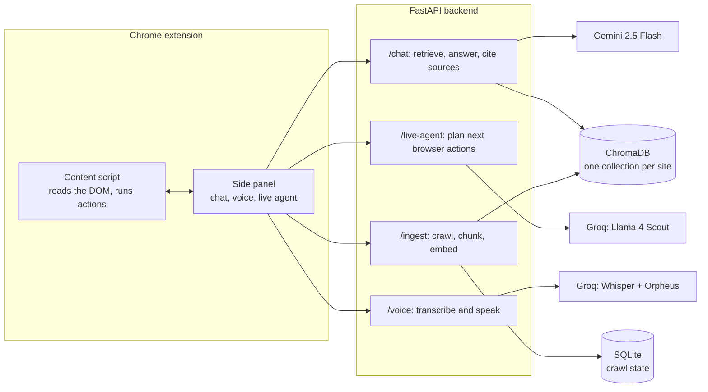

# Intercom: ask any website

A Chrome side-panel agent that answers questions about any website and can act on it. It crawls the site, indexes its pages and PDFs, answers with sources, navigates for you, and supports voice in and out.

Built as my Web Technology Lab project (6th semester, PICT). The demo indexes [pict.edu](https://pict.edu): admissions, cut-offs, fees, departments and placement pages.

## What it does

- **Crawls a whole site.** Playwright follows same-site links, reuses the user's cookies so logged-in pages work, and pulls text from HTML and PDFs (PyMuPDF, with Tesseract OCR for scanned PDFs).
- **Answers with sources.** Pages are chunked (about 500 tokens with overlap), embedded with Gemini and stored in one ChromaDB collection per site. Every answer lists the pages it came from.
- **Keeps working when the model doesn't.** If the LLM hits a rate limit or the context is too large, the backend falls back to the best matching lines from the live page and the index, and does simple sums and averages over them.
- **Acts on the page.** A live agent (Llama 4 Scout on Groq) plans at most 3 browser actions per step: navigate, click or scroll. It only uses URLs and selectors found on the page, never repeats a failed action, and stops to ask before credentials, payments, account creation or anything irreversible.
- **Talks.** Speech-to-text with Whisper large-v3-turbo and text-to-speech with Orpheus, both on Groq.

## How it works



## Stack

Chrome MV3 extension in plain HTML, CSS and JavaScript · FastAPI · Playwright · ChromaDB · SQLite · Gemini (chat and embeddings) · Groq (live agent, speech-to-text, text-to-speech) · PyMuPDF and Tesseract

## Run it locally

```bash
cd backend
python -m venv .venv && source .venv/bin/activate
pip install -r requirements.txt
playwright install chromium
cp .env.example .env          # add GOOGLE_API_KEY and GROQ_API_KEY
uvicorn main:app --reload --port 8000
```

Then open `chrome://extensions`, turn on Developer mode, click **Load unpacked** and pick the `extension/` folder. Open any site, open the Intercom side panel and click **Activate**.

`scripts/pict-demo-urls.json` holds the curated pict.edu URL list used for the demo. `scripts/reset-fresh.sh` wipes the local index and crawl state.
